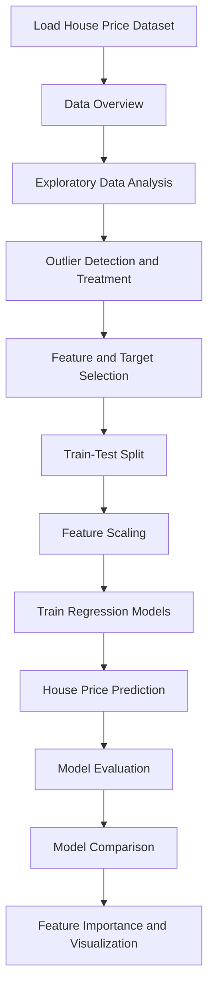

# EX.NO.4a – MACHINE LEARNING MODEL – LINEAR REGRESSION
## AIM
To predict house prices using regression models and compare the performance of different machine learning regression models based on RMSE, MAE, and R² evaluation metrics.
## THEORY
Machine Learning is a branch of Artificial Intelligence that enables computers to learn patterns from existing data and make predictions without being explicitly programmed.
Regression is a supervised learning technique used to predict continuous numerical values. In this experiment, different regression algorithms are applied to predict house prices based on house-related features.
**Features used in the dataset:**
1. **square_feet:** Total area or size of the house.
2. **num_rooms:** Number of rooms in the house.
3. **age:** Age of the house in years.
4. **distance_to_city(km):** Distance of the house from the city centre.
**Target Variable:**
- **price:** The actual price of the house.
## DATASET DESCRIPTION
- Dataset: House Price Dataset
- Problem: House Price Prediction
- Input Features (X): square_feet, num_rooms, age, distance_to_city(km)
- Target Variable (Y): price
## PROBLEM STATEMENT
1. Develop a machine learning model to predict house prices.
2. Use house characteristics as input features.
3. Train different regression models.
4. Compare their prediction performance.
5. Select the better-performing model based on evaluation metrics.
## REGRESSION MODELS USED
The following ten regression models are implemented and compared:
1. Linear Regression
2. Ridge Regression
3. Lasso Regression
4. ElasticNet Regression
5. Polynomial Regression
6. Decision Tree Regressor
7. Random Forest Regressor
8. Gradient Boosting Regressor
9. Support Vector Regressor (SVR)
10. K-Nearest Neighbors (KNN) Regressor
## LIBRARIES USED
- **Pandas:** Used for loading and manipulating datasets.
- **NumPy:** Used for numerical operations.
- **Matplotlib:** Used for data visualization.
- **Seaborn:** Used for statistical graphs and visualization.
- **Scikit-learn:** Used for implementing machine learning algorithms and evaluating models.
## PROCEDURE
1. Import the required Python libraries.
2. Load the house price dataset using Pandas.
3. Display the first five records of the dataset.
4. Examine the dataset using info(), shape(), and describe().
5. Check for missing values in the dataset.
6. Perform Exploratory Data Analysis (EDA).
7. Visualize feature distributions using histograms.
8. Perform correlation analysis using a heatmap.
9. Analyze relationships between features and house prices using scatter plots.
10. Detect outliers using boxplots.
11. Remove extreme house prices using the 1st and 99th percentiles.
12. Separate independent variables (X) and dependent variable (y).
13. Split the dataset into training and testing sets.
14. Apply StandardScaler for feature scaling.
15. Train different regression models.
16. Predict house prices using each trained model.
17. Evaluate the models using RMSE, MAE, and R².
18. Compare the performance of all regression models.
19. Visualize actual versus predicted prices and perform residual analysis.
20. Identify important features using Random Forest and Gradient Boosting.
## PROGRAM
### Step 1: Import Required Libraries
```python
import pandas as pd
import numpy as np
import matplotlib.pyplot as plt
import seaborn as sns
from sklearn.model_selection import train_test_split
from sklearn.preprocessing import StandardScaler, PolynomialFeatures
from sklearn.linear_model import (
    LinearRegression, Ridge, Lasso, ElasticNet
)
from sklearn.tree import DecisionTreeRegressor

from sklearn.ensemble import (
    RandomForestRegressor,
    GradientBoostingRegressor
)

from sklearn.svm import SVR
from sklearn.neighbors import KNeighborsRegressor
from sklearn.metrics import (
    mean_squared_error,
    mean_absolute_error,
    r2_score
)
```

### Step 2: Load the Dataset

```python
df = pd.read_csv(
    '/content/drive/MyDrive/Datasets/house_prices_dataset.csv'
)
df.head()
```

### Step 3: Data Overview

```python
# Display dataset
print(df)

# Display information
df.info()

# Display shape
print(df.shape)

# Summary statistics
print(df.describe())

# Check missing values
print(df.isnull().sum())
```

### Step 4: Exploratory Data Analysis (EDA)

```python
numeric_features = [
    'square_feet',
    'num_rooms',
    'age',
    'distance_to_city(km)',
    'price'
]
for col in numeric_features:
    plt.figure(figsize=(6,4))
    sns.histplot(df[col], kde=True, bins=30)
    plt.title(f'Distribution of {col}')
    plt.show()
```

### Step 5: Correlation Analysis

```python
plt.figure(figsize=(8,6))
sns.heatmap(
    df.corr(),
    annot=True,
    cmap='coolwarm',
    fmt=".2f"
)
plt.title("Feature Correlation Matrix")
plt.show()
```

### Step 6: Scatter Plots

```python
for col in [
    'square_feet',
    'num_rooms',
    'age',
    'distance_to_city(km)'
]:
    plt.figure(figsize=(6,4))
    sns.scatterplot(x=df[col], y=df['price'])
    plt.title(f'{col} vs Price')
    plt.show()
```

### Step 7: Outlier Detection

```python
for col in [
    'square_feet',
    'num_rooms',
    'age',
    'distance_to_city(km)',
    'price'
]:
    plt.figure(figsize=(6,4))
    sns.boxplot(x=df[col])
    plt.title(f'Boxplot of {col}')
    plt.show()
```

### Step 8: Outlier Treatment

```python
Q1 = df['price'].quantile(0.01)
Q99 = df['price'].quantile(0.99)
df = df[
    (df['price'] >= Q1) &
    (df['price'] <= Q99)
]
```

The 1st and 99th percentiles are used to remove extremely low and high house prices.

### Step 9: Define Features and Target

```python
X = df[
    [
        'square_feet',
        'num_rooms',
        'age',
        'distance_to_city(km)'
    ]
]
y = df['price']
```

### Step 10: Train-Test Split

```python
X_train, X_test, y_train, y_test = train_test_split(
    X,
    y,
    test_size=0.2,
    random_state=42
)
```

- 80% of the data is used for training.
- 20% of the data is used for testing.

### Step 11: Feature Scaling

```python
scaler = StandardScaler()
X_train_scaled = scaler.fit_transform(X_train)
X_test_scaled = scaler.transform(X_test)
```

### Step 12: Baseline Model

```python
y_pred_baseline = (
    np.mean(y_train) * np.ones_like(y_test)
)
rmse_baseline = np.sqrt(
    mean_squared_error(y_test, y_pred_baseline)
)
mae_baseline = mean_absolute_error(
    y_test,
    y_pred_baseline
)
print(
    f"Baseline RMSE: {rmse_baseline:.2f}, "
    f"MAE: {mae_baseline:.2f}"
)
```

### Step 13: Linear Regression

```python
lr = LinearRegression()
lr.fit(X_train_scaled, y_train)
y_pred_lr = lr.predict(X_test_scaled)
```

### Step 14: Ridge Regression

```python
ridge = Ridge(alpha=1.0)
ridge.fit(X_train_scaled, y_train)
y_pred_ridge = ridge.predict(X_test_scaled)
```

### Step 15: Lasso Regression

```python
lasso = Lasso(alpha=0.1)
lasso.fit(X_train_scaled, y_train)
y_pred_lasso = lasso.predict(X_test_scaled)
```

### Step 16: ElasticNet Regression

```python
elastic = ElasticNet(
    alpha=0.1,
    l1_ratio=0.5
)
elastic.fit(X_train_scaled, y_train)
y_pred_elastic = elastic.predict(X_test_scaled)
```

### Step 17: Polynomial Regression

```python
poly = PolynomialFeatures(degree=2)
X_train_poly = poly.fit_transform(X_train_scaled)
X_test_poly = poly.transform(X_test_scaled)
poly_lr = LinearRegression()
poly_lr.fit(X_train_poly, y_train)
y_pred_poly = poly_lr.predict(X_test_poly)
```

### Step 18: Decision Tree Regressor

```python
dt = DecisionTreeRegressor(
    random_state=42
)

dt.fit(X_train_scaled, y_train)

y_pred_dt = dt.predict(X_test_scaled)
```

### Step 19: Random Forest Regressor

```python
rf = RandomForestRegressor(
    n_estimators=100,
    random_state=42
)

rf.fit(X_train_scaled, y_train)

y_pred_rf = rf.predict(X_test_scaled)
```

### Step 20: Gradient Boosting Regressor

```python
gbr = GradientBoostingRegressor(
    n_estimators=100,
    learning_rate=0.1,
    random_state=42
)

gbr.fit(X_train_scaled, y_train)

y_pred_gbr = gbr.predict(X_test_scaled)
```

### Step 21: Support Vector Regressor (SVR)

```python
svr = SVR(
    kernel='rbf',
    C=100,
    gamma=0.1,
    epsilon=.1
)

svr.fit(X_train_scaled, y_train)

y_pred_svr = svr.predict(X_test_scaled)
```

### Step 22: KNN Regressor

```python
knn = KNeighborsRegressor(
    n_neighbors=5
)

knn.fit(X_train_scaled, y_train)

y_pred_knn = knn.predict(X_test_scaled)
```

### Step 23: Model Evaluation

The following evaluation metrics are used:
- **RMSE (Root Mean Squared Error):** Measures the square root of the average squared prediction error. Lower values indicate better performance.
- **MAE (Mean Absolute Error):** Measures the average absolute difference between actual and predicted values. Lower values indicate better performance.
- **R² Score:** Measures how well the model explains the variation in house prices. Higher values generally indicate better performance.

```python
models = {
    "Linear Regression": y_pred_lr,
    "Ridge": y_pred_ridge,
    "Lasso": y_pred_lasso,
    "ElasticNet": y_pred_elastic,
    "Polynomial Regression": y_pred_poly,
    "Decision Tree": y_pred_dt,
    "Random Forest": y_pred_rf,
    "Gradient Boosting": y_pred_gbr,
    "SVR": y_pred_svr,
    "KNN": y_pred_knn
}

results = []

for name, y_pred in models.items():

    rmse = np.sqrt(
        mean_squared_error(y_test, y_pred)
    )

    mae = mean_absolute_error(
        y_test, y_pred
    )

    r2 = r2_score(
        y_test, y_pred
    )

    results.append([
        name,
        rmse,
        mae,
        r2
    ])

results_df = pd.DataFrame(
    results,
    columns=["Model", "RMSE", "MAE", "R2"]
)

results_df.sort_values(
    by="RMSE"
)
```

## MODEL COMPARISON
The performance of all ten regression models is compared using RMSE, MAE, and R².
### Comparison Criteria
- Lower RMSE indicates better prediction performance.
- Lower MAE indicates smaller prediction errors.
- Higher R² indicates better explanation of the target variable.
The model with the lowest RMSE is considered the best-performing model according to this evaluation metric.
## ACTUAL VS PREDICTED PRICE
```python
plt.figure(figsize=(15,12))
for i, (name, y_pred) in enumerate(models.items()):
    plt.subplot(5,2,i+1)
    plt.scatter(
        y_test,
        y_pred,
        alpha=0.5
    )
    plt.plot(
        [y_test.min(), y_test.max()],
        [y_test.min(), y_test.max()],
        'r--'
    )
    plt.xlabel("Actual Price")
    plt.ylabel("Predicted Price")
    plt.title(f"{name}: Actual vs Predicted")
plt.tight_layout()
plt.show()
```

The graph compares actual house prices with predicted prices. Points closer to the diagonal line indicate better predictions.
## RESIDUAL ANALYSIS
A residual is the difference between the actual price and the predicted price.
**Residual = Actual Price − Predicted Price**
```python
for name, y_pred in models.items():
    residuals = y_test - y_pred
    plt.figure(figsize=(6,4))
    sns.scatterplot(
        x=y_pred,
        y=residuals,
        alpha=0.5
    )
    plt.axhline(
        0,
        color='r',
        linestyle='--'
    )
    plt.xlabel("Predicted Price")
    plt.ylabel("Residuals")
    plt.title(f"{name}: Residual Plot")
    plt.show()
```
- Residuals close to zero indicate smaller prediction errors.
- Residual plots help identify unusual prediction patterns.

## RANDOM FOREST FEATURE IMPORTANCE

```python
importances = rf.feature_importances_
feat_names = X.columns
plt.figure(figsize=(6,4))
sns.barplot(
    x=importances,
    y=feat_names
)
plt.title("Random Forest Feature Importance")
plt.show()
```

This analysis identifies which house features contribute more to the Random Forest prediction.

## GRADIENT BOOSTING FEATURE IMPORTANCE

```python
importances_gbr = gbr.feature_importances_

plt.figure(figsize=(6,4))

sns.barplot(
    x=importances_gbr,
    y=feat_names
)
plt.title("Gradient Boosting Feature Importance")

plt.show()
```
This graph shows the relative contribution of different house features to the Gradient Boosting model.

## RMSE COMPARISON GRAPH

```python
plt.figure(figsize=(10,6))
sns.barplot(
    x="RMSE",
    y="Model",
    data=results_df.sort_values("RMSE")
)
plt.title("RMSE Comparison Across Regression Models")
plt.show()
```
The graph provides a visual comparison of prediction errors across all regression models. The model with the lowest RMSE performs best according to this metric.

## MACHINE LEARNING WORKFLOW



## RESULT
Thus, Linear Regression and other regression models were successfully applied for house price prediction using Python and Scikit-learn. The performance of ten different regression algorithms was evaluated and compared using RMSE, MAE, and R² metrics. Actual versus predicted price analysis, residual analysis, and feature importance analysis were also performed successfully.

## CONCLUSION
The experiment demonstrates how different machine learning regression algorithms can be used for predicting house prices. The importance of data analysis, feature scaling, model training, evaluation metrics, and model comparison in developing an effective machine learning model was understood.
